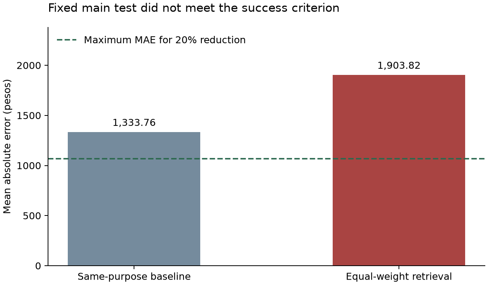
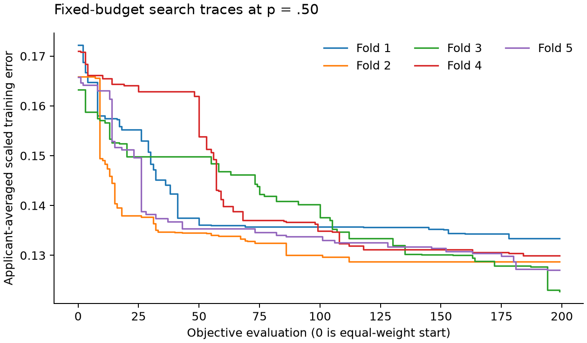
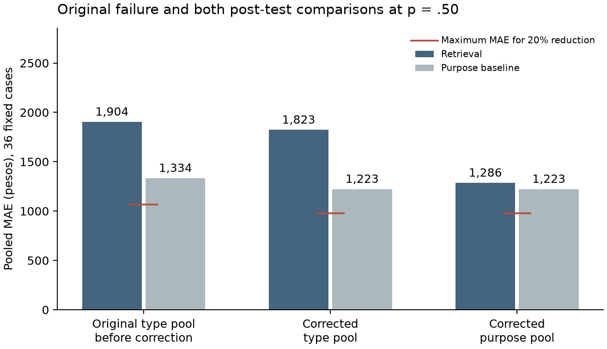

# Chapter 4
# Results and discussion

Draft for research-team review · version 2026-10-20-v03 · revision timestamp 20 October 2026, 20:49 PHT (UTC+08:00) · original failed results retained; post-test correction and both pool reruns reported

## 4.1 Scope and principal finding

This chapter reports the completed synthetic-data experiments for the AICS case
reference prototype. The fixed main test **failed**. On the 36 non-transport
reviewed cases at p = .50 and five retrieved neighbors, equal-weight retrieval
had mean absolute error (MAE) of **₱1,903.82**, compared with
**₱1,333.76** for the same-purpose baseline. The resulting
reduction was **-42.74%**, rather than the required
reduction of at least 20%. The maximum MAE compatible with that criterion was
₱1,067.01. These results do not establish that the proposed
retrieval method works on this dataset under the study's stated success criterion.

In the historical pre-correction run, all four non-medical assistance types show steadily increasing reductions in case-base retrieval error relative to their condition-specific purpose baselines as planted household signal increases; this ordered pattern is descriptive and does not change the fixed reviewed-case failure.

The historical type-pool weight-learning experiment improved over equal weights under its
specified tests. That finding addresses a different comparison and does not
replace the failed main test. In particular, improvement also appeared in the
no-household-signal control. It cannot, by itself, establish recovery of household
structure or usefulness in real benefit decisions.

All records and evaluated grants are synthetic. No social worker answered the case sheets or used the prototype in this study. There was no user acceptance testing (UAT), System Usability Scale (SUS) exercise, or collection of social-worker judgments. “Reviewed cases” below names the supplied forty-case packet and does not denote human outcome evaluation. The current Chapters 1–3 source is Manuscript v27 dated 20 October 2026.

The pool amendment and the missing-value correction were decided after the fixed main test had been run and had failed. Both the original type-pool result and the amended purpose-pool result are reported, and the original result is not withdrawn.

Henri authorized the two amendments on 20 October 2026 without first seeking Ma’am Grace’s agreement. No adviser approval or prospective registration of the amendments is claimed. The settings for the new comparisons were recorded before generating corrected outcomes. Sections 4.2–4.10 retain the historical pre-correction study, including its failed results and diagnostic analyses; Sections 4.13–4.17 report the new follow-ups. This chapter ends at Chapter 4.

## 4.2 Historical implementation and provenance

The comparison uses the 39 fields specified in the manuscript, same-type reference
pools, applicant-level exclusion, reference-only numeric ranges and constants,
Jaccard scores for multi-select fields, and the specified treatment of unknowns,
not-applicable values and shared absences. All events of a held-out applicant are
excluded. The reviewed cases are never inserted into the case base; the evaluator
also applies their documented partner exclusions. The prototype displays five
past cases using equal weights and does not output a prediction or applicant score.

The reconciled implementation restores the supplied amount-code scoring semantics
and sorted-payload noise algorithm. Compatibility tests reproduce all 160 supplied
forty-case amounts with the supplied calibration. The study run instead uses the
required calibration from the 1,000-event case base and reuses it for the forty
test cases. Per-event scoring avoids the source script's repeated-applicant
overwrite. Cost and rounding constraints are enforced explicitly.

Researcher-selected cost ranges were retained from the earlier preparation, not
changed in response to its failed result. They use uniform intervals from 0.5 to
1.5 times available cost benchmarks; device and transport ranges remain declared
assumptions. Educational costs use a tuition proxy. Laboratory uses the published
ratio .9052; dialysis and chemotherapy each use .3556 from their combined source
row. These completions and proxies must remain disclosed in the methodology.

The existing base had 244 wage-label contradictions. The reconciled copy removes
the contradictory labels without changing incomes or worker counts. New generated
sets enforce that consistency before inserting unknown values. Ten original-base
events remain unverifiable because worker counts are missing; they are flagged,
not presented as validated. Unknown values are still excluded from Gower. The
source amount rule's distinct missing-score semantics are preserved and are a
limitation of the synthetic mechanism.

The earlier provisional run is retained separately: its main-test retrieval MAE
was ₱1,930.18 against ₱923.49, a −109.01% reduction. The reconciled run is a distinct
version justified by source compatibility, not a replacement advertised as success.

The purpose-baseline MAE also rose from ₱923.49 in the provisional run to ₱1,333.76 in the reconciled run (44.43%); reconciliation changed the generated outcomes and calibration used by the comparator, so this is a change of run definition, not an improvement measured against a fixed baseline.

## 4.3 Data composition and published benchmarks

The primary base contains 1,000 events from 844 applicant IDs. The published-mix
column below is the comparator recorded in the supplied figures module (Table 12);
the synthetic mix was deliberately flattened. It is not a sampled Davao City
population distribution. Rounded published percentages sum to approximately 100%.

| Assistance type | Generated events | Generated % | Bundle published comparator % |
| --- | --- | --- | --- |
| Cash Relief Assistance | 100 | 10.0 | 8.3 |
| Educational | 80 | 8.0 | 4.0 |
| Food Assistance | 80 | 8.0 | 3.8 |
| Funeral | 150 | 15.0 | 12.3 |
| Medical | 510 | 51.0 | 70.6 |
| Transportation | 80 | 8.0 | 1.1 |

The flattened mix cuts against the study’s interpretation: medical represents 51.0% of generated events versus 70.6% in the supplied published comparator. Because medical has the largest error and baseline deficit, a more medical-heavy mix would worsen the pooled result if the observed within-type errors held fixed. This is a composition sensitivity interpretation, not an estimate from a representative population or a newly generated sample.

Six-month income bands are retained as generated, without balancing them to improve detectability.

| Income band | Base events | Reviewed cases |
| --- | --- | --- |
| Below food threshold | 529 | 26 |
| Food to poverty threshold | 148 | 7 |
| At or above poverty threshold | 271 | 7 |
| Unknown | 52 | 0 |

The cost checks below compare generated means with the historical published anchors, not current benefit policy. No post-result cost adjustment was made.

| Group | Published mean cost ₱ | Generated mean cost ₱ | Difference % | Within 20% |
| --- | --- | --- | --- | --- |
| Hospital bill | 147,375.00 | 150,927.42 | 2.41 | True |
| Funeral | 45,230.74 | 46,048.33 | 1.81 | True |
| Medicines | 7,831.71 | 7,949.84 | 1.51 | True |
| Laboratory | 5,800.00 | 6,040.52 | 4.15 | True |
| Educational | 11,700.00 | 11,261.25 | -3.75 | True |
| Chemotherapy | 23,142.86 | 21,652.78 | -6.44 | True |
| Dialysis | 23,142.86 | 24,555.26 | 6.10 | True |

The following p = .50 summaries compare aggregate generated shares (total grants divided by total costs) with the declared share bases. Food and cash relief instead compare mean amounts in pesos. Shares are not mean individual ratios. The borrowed device share and exact transport share are assumptions, not Region XI estimates.

| Purpose | n | Generated share or mean ₱ | Rule base share or mean ₱ |
| --- | --- | --- | --- |
| Allowance | 19 | 0.6540 | 0.6105 |
| Assistive device | 14 | 0.4009 | 0.3556 |
| Cadaver transfer | 16 | 0.3313 | 0.2903 |
| Chemotherapy | 18 | 0.3525 | 0.3556 |
| Dialysis | 19 | 0.3479 | 0.3556 |
| Food subsidy | 80 | 4,096.25 | 3,857.14 |
| Funeral expenses | 134 | 0.3057 | 0.2903 |
| Hospital bill | 93 | 0.2121 | 0.2075 |
| Laboratory | 58 | 0.8163 | 0.9052 |
| Medicines | 308 | 0.7780 | 0.8046 |
| Other needs | 100 | 4,687.50 | 4,400.00 |
| School fees | 35 | 0.6381 | 0.6105 |
| School supplies | 26 | 0.6223 | 0.6105 |
| Transportation for medical treatment | 33 | 1.0000 | 1.0000 |
| Transportation to home province | 47 | 1.0000 | 1.0000 |

The published amounts and costs were reported for a historical population and may
include payments by other sources. Here documented cost is the outstanding need.
Agreement of selected summary means therefore supports a limited plausibility
check, not population validity or proof of realistic joint relationships.

## 4.4 Missingness and effective comparisons

Unknown entries are not imputed into the distance. Explicit No and not-applicable
values follow the manuscript's separate rules. The primary base has the following
unknown counts among matching fields; rates use 1,000 events as the denominator.

| Matching field | Unknown events | Unknown % |
| --- | --- | --- |
| client_type | 0 | 0.0 |
| crisis_catastrophic_event | 21 | 2.1 |
| crisis_death_of_member | 14 | 1.4 |
| crisis_disablement | 19 | 1.9 |
| crisis_hospitalization | 28 | 2.8 |
| crisis_last_3_months | 27 | 2.7 |
| crisis_loss_of_livelihood | 25 | 2.5 |
| crisis_others | 15 | 1.5 |
| disability_type | 2 | 0.2 |
| emergency_fund | 23 | 2.3 |
| employed_members | 14 | 1.4 |
| ext_guarantee_letter_other_agency | 19 | 1.9 |
| ext_health_card | 18 | 1.8 |
| ext_mss_discount | 23 | 2.3 |
| ext_philhealth | 26 | 2.6 |
| ext_pwd_discount | 24 | 2.4 |
| ext_senior_citizen_discount | 17 | 1.7 |
| illness_duration | 14 | 1.4 |
| insurance_coverage | 21 | 2.1 |
| monthly_expenses | 45 | 4.5 |
| occupation | 15 | 1.5 |
| purpose_of_assistance | 0 | 0.0 |
| referral_type | 23 | 2.3 |
| savings | 19 | 1.9 |
| seasonal_members | 19 | 1.9 |
| selfhelp_reached_agencies | 24 | 2.4 |
| selfhelp_sought_income | 22 | 2.2 |
| service_setting | 21 | 2.1 |
| sub_category | 22 | 2.2 |
| support_church | 18 | 1.8 |
| support_employer | 28 | 2.8 |
| support_family | 17 | 1.7 |
| support_friends | 12 | 1.2 |
| support_relatives | 15 | 1.5 |
| target_sector | 0 | 0.0 |
| total_income_past_6_months | 52 | 5.2 |
| vuln_elderly_child_pwd_pregnant | 18 | 1.8 |
| vuln_member_incapacitated | 20 | 2.0 |
| vuln_unstable_employment | 32 | 3.2 |

At p = .50, the equal-weight retrieved pairs compared between 24 and
36 fields (median 31). Learned-weight retrieved
pairs had between 21 and 34 comparable fields with positive
weight (median 28). The equal-weight primary run counted
0 undefined eligible pairs. The machine-readable results retain each
neighbor's count; available-field counts and positive-weight counts are distinguished.

The source schema lacks the separate Section V not-applicable tick, so all-No
resource rows cannot independently establish whether that tick was recorded.
The supplied explicit No values are retained with a provenance warning. This
cannot be repaired by inferring an unrecorded answer.

### Exact record-level completeness

Counting the existing CSV records directly gives the following completeness figures. Unknown means an empty or explicitly unrecorded value under the existing loader; explicit No, numeric zero and recorded not-applicable values are not counted as unknown. These are event counts, not counts of distinct applicants.

| Dataset | Field scope | Events | Unknown cells | Complete events | Incomplete events |
| --- | --- | --- | --- | --- | --- |
| Primary case base | 39 matching fields | 1000 | 772 | 463 | 537 |
| Primary case base | 28 household-rule fields | 1000 | 606 | 545 | 455 |
| Frozen reviewed cases | 39 matching fields | 40 | 21 | 22 | 18 |
| Frozen reviewed cases | 28 household-rule fields | 40 | 14 | 27 | 13 |

For the 39 matching fields, 463 of 1,000 events (46.3%) are complete. The 772 unknown cells give a mean cell-level rate of 1.98%; multiplying the per-field observed proportions under an independence assumption would predict approximately 457.6 complete events, but the actual joint count is 463. For the correction to the household score, the relevant direct count is narrower: 455 events (45.5%) have an unknown in at least one of its 28 fields, containing 606 unknown cells. The other 545 events have complete household-rule inputs. Missingness is therefore material, even though the typical per-field rate is small.

Across the frozen 40-case source file, excluding the blank outcome column, there are 287 unknown cells in 21 columns and every case has at least one. That broader scope includes context and income-source fields not used in matching or the household score. Within the 39 matching fields, only 18 cases have unknowns (21 cells); within the 28 household-rule fields, 13 have unknowns (14 cells). The statement that all 40 source cases contain an unrecorded entry must not be read as saying all 40 household scores are incomplete.

The intake inputs remain frozen. The post-test correction in Section 4.13 handles existing unknowns through bounded available-field aggregation. It preserves complete records’ raw household scores, but recalibration can change their standardized scores and generated grants. Rounding and bounds can also preserve some grants. These follow-ups are new versions authorized after the original failure, and all prior runs are retained.

## 4.5 Historical separate-set selection of money and duration treatments

A separate primary set used master seed 41000; thirty new sets used 41001–41030.
All selection comparisons used equal weights and p = .50. Money transformations
were compared first, then duration under the selected money treatment. The
criterion used applicant-averaged scaled absolute errors, with transportation
excluded because it has no scaled width and its grant is exactly its ticket cost.
The noise floor was the sample SD of the thirty paired mean gaps. Each challenger
also had to pass the primary-set two-sided Wilcoxon test, with α = .025 for money
and α = .05 for duration. Applicants, not a pooled stack of replicated IDs, were
the paired units. All-zero differences would give p = 1.

| Comparison | Mean scaled improvement | Noise-floor SD | Wilcoxon p | Passes both |
| --- | --- | --- | --- | --- |
| Log versus plain | 0.001083 | 0.002761 | 0.268 | False |
| Fuzzy versus plain | 0.002880 | 0.002999 | 0.849 | False |
| Rank versus categorical duration | 0.000394 | 0.001464 | 0.195 | False |

The retained settings are **plain money scaling** and **categorical duration**. Failure to pass is not proof of equivalent methods; it means the fixed implementation criterion did not justify replacing the baseline.

For transparency, these are medians of the query-specific reference-pool income quartiles on the separate primary set. Each actual query used its own eligible pool. The signed percentage differences compare Q2 with the food edge and Q3 with the poverty edge.

| Type | Q1 ₱ | Q2 ₱ | Q3 ₱ | Q2–food edge % | Q3–poverty edge % |
| --- | --- | --- | --- | --- | --- |
| Cash Relief Assistance | 24,900.00 | 46,950.00 | 83,300.00 | -14.89 | 5.71 |
| Educational | 16,300.00 | 43,900.00 | 77,700.00 | -20.42 | -1.40 |
| Food Assistance | 17,325.00 | 44,600.00 | 80,200.00 | -19.15 | 1.77 |
| Funeral | 12,850.00 | 40,750.00 | 71,400.00 | -26.13 | -9.39 |
| Medical | 18,525.00 | 43,300.00 | 86,625.00 | -21.50 | 9.93 |
| Transportation | 13,150.00 | 33,200.00 | 81,700.00 | -39.81 | 3.68 |

Fuzzy membership used linear low/middle/high memberships anchored at these
quartiles, with similarity equal to one minus half their L1 distance. Coincident
quartiles triggered a recorded plain-range fallback. These are explicitly
documented implementation choices, not formulas supplied verbatim in the paper.

## 4.6 Original fixed reviewed-case test before correction

For cost-bearing cases, retrieval combines the five recorded grant-to-cost ratios
by their median and applies it to the query's own cost. Direct food/cash amounts
are combined by their median. The baseline uses the same-purpose eligible pool
with the same exclusions. The following p = .50 results are descriptive by type;
the success criterion is the pooled 36-case peso comparison, not a type-specific
or scaled-error substitute.

| Type | Cases | Retrieval MAE ₱ | Purpose-baseline MAE ₱ | Reduction % | Scaled MAE |
| --- | --- | --- | --- | --- | --- |
| Cash Relief Assistance | 5 | 590.00 | 520.00 | -13.46 | 0.065556 |
| Educational | 5 | 1,116.86 | 1,068.97 | -4.48 | 0.248191 |
| Food Assistance | 4 | 325.00 | 512.50 | 36.59 | 0.162500 |
| Funeral | 8 | 1,648.39 | 2,612.43 | 36.90 | 0.082419 |
| Medical | 14 | 3,251.16 | 1,222.94 | -165.85 | 0.055393 |
| Transportation | 4 | 0.00 | 0.00 | N/A | N/A |

The four transportation cases have zero error by construction. They are reported separately and do not count toward the main test. Plain and selected settings coincide in this run. Results across all conditions are:

| Household condition | 36-case MAE ₱ | Purpose-baseline MAE ₱ | Reduction % |
| --- | --- | --- | --- |
| p00 | 2,205.44 | 1,805.07 | -22.18 |
| p25 | 2,096.81 | 1,361.40 | -54.02 |
| p50 | 1,903.82 | 1,333.76 | -42.74 |
| p75 | 1,542.06 | 1,127.28 | -36.79 |

### Medical error diagnosis

Medical assistance accounts for 14 of 36 cases (38.9%) but **66.4% of total retrieval absolute error**. Its retrieval MAE is ₱3,251.16 against ₱1,222.94 for the purpose baseline, a −165.85% reduction. Medical is the source of the aggregate failure: the remaining 22 cases have retrieval MAE **₱1,046.43** against **₱1,404.29**, a **25.48% reduction**.

| Diagnostic subset | Cases | Retrieval MAE ₱ | Purpose-baseline MAE ₱ | Reduction % |
| --- | --- | --- | --- | --- |
| All non-transport cases — fixed main test | 36 | 1,903.82 | 1,333.76 | −42.74 |
| Medical | 14 | 3,251.16 | 1,222.94 | −165.85 |
| Non-medical non-transport — post-result diagnosis | 22 | 1,046.43 | 1,404.29 | 25.48 |

The 22-case subset exceeds 20% descriptively; it is not a replacement success test and does not change the failed 36-case conclusion. Cash relief and education individually remain below their baselines. The diagnosis concerns the aggregate concentration of error, not a claim that every non-medical type passes.

| Assistance type | Purpose and base share or direct amount |
| --- | --- |
| Medical | Hospital bill .2075; dialysis .3556; chemotherapy .3556; assistive device .3556; medicines .8046; laboratory .9052 |
| Funeral | Funeral expenses and cadaver transfer: .2903 each |
| Educational | Allowance, school fees and school supplies: .6105 each |
| Food assistance | Single purpose, food subsidy: direct base ₱3,857.14 |
| Cash relief | Single purpose, other needs: direct base ₱4,400.00 |
| Transportation | Both purposes: 1.0000; exact cost with no household adjustment |

Medical is the only type with different purpose-specific base shares, spanning .2075–.9052. The baseline is conditioned on purpose, while retrieval pools by type and gives purpose one of 39 equal nominal weights (1/39, about 2.6%; the effective share depends on the available-field denominator). A medicines query can therefore retrieve hospital-bill cases with a much lower base share. This is the mechanism supported by the error concentration and the known rule; the existing comparisons do not isolate its causal contribution from every other generator limitation.

The separate case-base experiment corroborates the role of purpose: its mean learned weight is 2.9797, compared with 1.5750 for the next field. At p = .50, medical's applicant-averaged reduction changes from −340.42% under equal weights to −20.36% under learned weights, the largest type-specific improvement. These are case-base results, not the 14 reviewed-case results above.

### Retrieval error across household-signal levels

Appendix 4A also supports an ordered comparison across the four planted household-signal conditions. The following figures are case-base results: errors are first averaged within applicant and assistance type across the 1,000 events, then across applicants in that type. They are distinct from the fixed 36 reviewed-case test. Each percentage uses its own condition-specific purpose baseline, which changes because the generated amounts change with the condition. Transportation is excluded here because its error is zero by construction.

**Equal weights — reduction against the matching purpose baseline (%)**

| Assistance type | p00 | p25 | p50 | p75 | Strictly increasing |
| --- | --- | --- | --- | --- | --- |
| Cash relief | -14.28 | -10.41 | +0.66 | +10.02 | Yes |
| Educational | -3.33 | -1.83 | +9.89 | +16.59 | Yes |
| Food | -13.50 | -12.94 | -1.35 | +23.02 | Yes |
| Funeral | -7.31 | -5.15 | +3.47 | +14.81 | Yes |
| Medical | -360.43 | -387.41 | -340.42 | -332.69 | No |

For each of the four non-medical types, the equal-weight reduction increases at every step as the household share of variation rises from 0% to 75%. All four trail their purpose baseline at p00, where there is no household signal, and all four exceed it at p75. This dose-response pattern is consistent with retrieval responding to planted household information where the medical purpose-share mismatch is absent. Medical remains far below its baseline throughout; its equal-weight sequence is non-monotonic, rather than literally constant or evidence of statistical equivalence.

**Learned weights — reduction against the matching purpose baseline (%)**

| Assistance type | p00 | p25 | p50 | p75 | Strictly increasing |
| --- | --- | --- | --- | --- | --- |
| Cash relief | -12.28 | -15.09 | +2.31 | +13.35 | No |
| Educational | -4.51 | -16.58 | +5.04 | +12.30 | No |
| Food | -24.08 | -3.75 | +2.54 | +16.53 | Yes |
| Funeral | -11.81 | -4.43 | +13.06 | +14.44 | Yes |
| Medical | -35.11 | -27.08 | -20.36 | +2.21 | Yes |

Under learned weights, medical improves monotonically from −35.11% at p00 through −27.08% and −20.36% to +2.21% at p75. This is consistent with emphasizing purpose reducing an obstacle to observing household-signal response. It does not isolate the effect of purpose from all other learned-weight changes. Food and funeral also increase monotonically. Cash relief and education dip at p25, so the learned-weight results must not be described as monotonic for every type.

These findings are compatible with Section 4.8. The weight search minimizes an applicant-averaged scaled-error objective across the whole case base and assigns its largest mean weight to purpose. Medical dominates the unscaled peso error under equal weights, but that alone does not establish its influence on the scaled optimization objective. The scaled-error breakdown below addresses that separate question using the saved errors. The observed weights and error changes support purpose as a major lever used by the search. They do not demonstrate additional household-pattern recovery by the search. Retrieval can nevertheless respond to household signal through fields already included under equal weights, as the non-medical ordered comparisons show. What the search emphasizes and what retrieval responds to are different findings.

There are only four points per type. This is a descriptive pattern, not a formal trend test; no statistical significance, fitted trend line or causal proof is claimed. These comparisons do not isolate the mechanism from the generator's other limitations. The main condition remains p = .50, fixed before evaluation. The better p75 results do not justify choosing a different main condition. The fixed reviewed-case test still failed at −42.74%, as Section 4.1 reports; this case-base analysis explains aspects of that result and does not overturn or replace it. It supports a household-signal response in the four non-medical types and a purpose-confusion explanation for medical that was not isolated in the original comparison; the post-test follow-ups are reported in Section 4.14.

### Scaled-error contribution and the observed trade-off

The scaled results allow a more direct check of medical's contribution. Multiplying each type's mean scaled error by its applicant count gives the approximate proxy below. Applicants appearing in more than one type are counted in more than one row, so that proxy is not a partition of the actual applicant-averaged objective.

| Type | Applicants in type | Equal scaled error | Overlapping-row proxy share % | Exact held-out objective share % |
| --- | --- | --- | --- | --- |
| Medical | 461 | 0.130962 | 41.4 | 43.34 |
| Food Assistance | 80 | 0.423750 | 23.2 | 22.14 |
| Educational | 78 | 0.307455 | 16.4 | 16.25 |
| Funeral | 143 | 0.122569 | 12.0 | 11.61 |
| Cash Relief Assistance | 98 | 0.102381 | 6.9 | 6.67 |

The exact column is reconstructed from the saved p = .50 held-out event errors, with no retrieval or fitting rerun. For each applicant a, divide each non-transport event error by that applicant's count of non-transport events; then sum those fractions by type and divide by the 794 applicants with a defined scaled error (844 total applicant IDs minus 50 transportation-only applicants, whose events have no scaled width). The contributions sum to the recorded equal-weight objective of 0.167927. Medical contributes 0.072774, or **43.34%**, the largest single block; the overlapping-row approximation is **41.4%**. These are the held-out errors under the fitted folds, not the training objective values evaluated inside each search. The same applicant-averaging convention underlies both, but the eligible reference pools differ.

| Type | Equal scaled error | Learned scaled error | Learned minus equal |
| --- | --- | --- | --- |
| Medical | 0.130962 | 0.080893 | -0.050069 |
| Food Assistance | 0.423750 | 0.407500 | -0.016250 |
| Educational | 0.307455 | 0.324025 | +0.016570 |
| Funeral | 0.122569 | 0.110388 | -0.012181 |
| Cash Relief Assistance | 0.102381 | 0.100680 | -0.001701 |

Medical has the largest decrease in per-type applicant-averaged scaled error, about 0.0501, roughly 3.1 times the next largest decrease (food, about 0.0163). Educational error instead rises by about 0.0166. The exact objective decomposition likewise assigns the largest reduction to medical: its contribution falls by 0.027421, while education's rises by 0.000915. The shared weights therefore produce an observed trade-off: substantially lower medical error accompanies higher educational error.

This is consistent with purpose being a lever used by the search and medical being where that lever paid off. It describes the outcome of the learned weights; it does not isolate the optimizer's internal reasons, prove that education was deliberately sacrificed, or establish that purpose was its only useful lever. Section 4.8's household-recovery conclusion remains unchanged.

## 4.7 Historical five-fold learned weights and thirty-set evidence

Applicant IDs were assigned to five fixed folds. Each fold's shared 39 weights
were fitted only on the other four folds, using applicant leave-one-out retrieval
inside that training pool and 200 objective evaluations. All weights were
nonnegative and summed to 39. Held-out applicants retrieved from all other
case-base applicants, including other applicants assigned to their test fold;
the equal-weight comparator used that identical reference pool. Settings selected
on the separate set were held fixed. No reviewed case selected weights or budget.

Thirty weight replicates used master seeds 51001–51030. The same two-part evidence
criterion was applied with α = .05 per specified condition. The paired test used
the primary case-base applicants. The following peso MAEs first average the
non-transport event errors within each applicant, then average applicants; scaled
errors similarly average each event's error divided by its prescribed band width.
This differs from an event-weighted pooled MAE when applicants have repeat visits.

| Condition | Equal MAE ₱ | Learned MAE ₱ | Paired mean peso gain | Purpose baseline ₱ | 30-set scaled gain | SD | Wilcoxon p | Passes |
| --- | --- | --- | --- | --- | --- | --- | --- | --- |
| p00 | 5,727.88 | 2,277.72 | 3,450.17 | 1,816.74 | 0.023033 | 0.005916 | 4.48e-08 | True |
| p25 | 6,104.25 | 2,195.81 | 3,908.43 | 1,860.05 | 0.022640 | 0.006526 | 1.14e-05 | True |
| p50 | 5,979.23 | 2,103.78 | 3,875.45 | 1,904.46 | 0.023645 | 0.005888 | 1.82e-07 | True |
| p75 | 6,142.67 | 1,904.88 | 4,237.79 | 2,032.60 | 0.025527 | 0.005086 | 2e-06 | True |

All four implemented signed-rank calculations were independently cross-checked
against SciPy 1.17.1 using the same two-sided asymptotic, tie-corrected convention.
SciPy was used for verification, not as a hidden optimizer dependency. The
condition-wise tests follow the stated protocol; no additional family-wide claim
across all conditions or descriptive k values is asserted.

The p = 0 improvement over equal weights is especially important for interpretation.
Purpose still determines base shares in that control, while household adjustment
is disabled. Learned weights can improve by emphasizing purpose and suppressing
irrelevant variation. Therefore this comparison alone cannot show that the search
recovered the household relationship. The purpose baseline remains the relevant
no-household comparison; the primary pooled learned peso error remains above it.
Any small subgroup fluctuation below that baseline is not, on its own, proof of
leakage or of a real household effect.

### Gain across household-signal levels

The thirty-set scaled gains are .023033, .022640, .023645 and .025527 at p = 0, .25, .50 and .75. Their spread is **0.002887**, smaller than the mean replicate SD of **0.005854**. The gain is descriptively flat rather than showing a clear increase with household signal. This range-to-SD comparison is a descriptive diagnostic, not a formal trend or equivalence test. Together with improvement at p = 0 and the weight-mass results below, it identifies purpose recovery without detectable household-pattern recovery at any tested signal level under this implementation and evidence. It does not prove that no household information could be recovered by any method.

## 4.8 Historical weight recovery and reference gap

The written household score uses 28 matching fields. Purpose also determines the
base share, so the amount-rule reference includes 29 matching fields. It assigns
equal positive weight to those 29 and zero to the other matching fields. Cost is
not a matching field and cannot enter this reference. This is a fixed nominal
rule-field diagnostic across conditions; p = 0 disables the household term.
Both purpose-inclusive and household-only weight masses are shown to avoid
mistaking purpose recovery for household recovery. The reference is not a proven
optimum. A negative learned-minus-reference gap is possible and is not an error.

| Condition | Mean rule-field weight % | Mean household-only weight % | Mean zero-rule fields in top 10 | Learned scaled error | Reference scaled error | Learned minus reference |
| --- | --- | --- | --- | --- | --- | --- |
| p00 | 79.45 | 71.45 | 2.20 | 0.156962 | 0.176583 | -0.019620 |
| p25 | 76.87 | 67.98 | 2.60 | 0.145766 | 0.167306 | -0.021540 |
| p50 | 79.25 | 71.61 | 1.80 | 0.138103 | 0.156741 | -0.018638 |
| p75 | 77.28 | 69.12 | 2.00 | 0.125454 | 0.145463 | -0.020009 |

### Household weight mass did not increase

| p = .50 household-only diagnostic | Weight mass |
| --- | --- |
| Equal weights on the 28 household-score fields | **71.79%** |
| Learned weights on the same fields | **71.61%** |
| Change | **−0.18 percentage points** |

Equal weights allocate 74.36% to all 29 nominal rule fields including purpose. The larger learned rule-field mass is driven chiefly by purpose, not increased household mass. Household-only mass is also below the equal-weight share at the other three signal levels in the table. **The weight search recovers purpose and does not detectably recover the household pattern at any tested signal level.** This is a finding about the present search and diagnostics; aggregate weight mass alone cannot rule out every redistribution among household fields.

Largest mean weights at p = .50 (all 39 weights and every candidate trace are retained in the evidence archive):

| Field | Mean weight | In nominal amount rule |
| --- | --- | --- |
| purpose_of_assistance | 2.9797 | True |
| employed_members | 1.5750 | True |
| ext_mss_discount | 1.4516 | True |
| ext_senior_citizen_discount | 1.3562 | True |
| total_income_past_6_months | 1.3125 | True |
| vuln_unstable_employment | 1.2688 | True |
| support_employer | 1.2625 | True |
| seasonal_members | 1.2000 | False |
| crisis_disablement | 1.1812 | True |
| ext_philhealth | 1.1500 | True |

Each search stopped at its fixed budget, not a claim of convergence to an optimum. The trace reports the incumbent after each candidate evaluation.

| Fold | Initial scaled objective | Final scaled objective | Last accepted evaluation | Accepted moves |
| --- | --- | --- | --- | --- |
| 1 | 0.172210 | 0.133434 | 178 | 25 |
| 2 | 0.165831 | 0.128744 | 112 | 26 |
| 3 | 0.163281 | 0.122800 | 199 | 32 |
| 4 | 0.171023 | 0.129934 | 184 | 30 |
| 5 | 0.165737 | 0.127070 | 194 | 26 |

## 4.9 Historical sensitivity to the number of retrieved cases

The following applicant-averaged scaled errors vary k while keeping the selected
settings and learned weights fixed. They are descriptive, with no retuning and
no additional superiority claim. The main test and fitting objective remain k=5.

| Condition | k | Equal scaled MAE | Learned scaled MAE |
| --- | --- | --- | --- |
| p00 | 3 | 0.189847 | 0.164333 |
| p00 | 5 | 0.182232 | 0.156962 |
| p00 | 7 | 0.179067 | 0.155340 |
| p00 | 10 | 0.173872 | 0.149234 |
| p25 | 3 | 0.183085 | 0.155071 |
| p25 | 5 | 0.171892 | 0.145766 |
| p25 | 7 | 0.164606 | 0.138290 |
| p25 | 10 | 0.160377 | 0.133942 |
| p50 | 3 | 0.174302 | 0.144091 |
| p50 | 5 | 0.167927 | 0.138103 |
| p50 | 7 | 0.159000 | 0.137273 |
| p50 | 10 | 0.157264 | 0.133901 |
| p75 | 3 | 0.162276 | 0.131079 |
| p75 | 5 | 0.153894 | 0.125454 |
| p75 | 7 | 0.150651 | 0.121224 |
| p75 | 10 | 0.148152 | 0.119983 |

## 4.10 Historical computational performance and reproducibility

Retrieval timing used three warmups and eleven timed calls for one fixed reviewed
query per assistance type, starting from the complete 1,000-event reference set.
These are function timings, not end-to-end network latency or a population-wide
latency estimate. Memory is the process working set after importing the backend
and loading the default CSV, measured in five fresh processes, not peak memory.

| Type | Query | Median retrieval ms |
| --- | --- | --- |
| Cash Relief Assistance | J07 | 2.595 |
| Educational | J02 | 2.127 |
| Food Assistance | J06 | 2.120 |
| Funeral | J04 | 3.771 |
| Medical | J01 | 11.503 |
| Transportation | J08 | 2.219 |

Median backend working set was 49.24 MiB.
The full five-fold, four-condition weight evaluation had median runtime
38.29 seconds across three deterministic
repetitions (36.11, 38.56, 38.29
seconds). The repeated learned outcomes and weights were identical. This time
includes distance construction, search, held-out evaluation and trace writes;
it excludes the thirty replicate runs, input generation, final document drafting,
and the later reporting-only reference/count supplement.

The recorded machine used 12th Gen Intel(R) Core(TM) i7-12700H,
15.63 GiB reported physical memory,
Microsoft Windows 11 Home Single Language version 10.0.26200, and Python
3.12.10. The tested frontend used React 19.3.0
and Vite 7.3.6. Exact installed Python versions and
the frontend lock file accompany the run. The configured repository is
`https://github.com/HenriDillo/aics-case-based-retrieval.git`; its private status was authenticated and verified on
19 October 2026. These historical records do not establish approval of the amendments.

## 4.11 Prototype and review status

The prototype still loads the historical reconciled p = .50 synthetic reference CSV once, retrieves
five same-type cases using equal weights, and displays their circumstances,
documented costs and generated grants. Browser checks across all six assistance types covered retrieval,
numeric grant display, comparison navigation and mobile overflow. The production
frontend build passed. The corrected offline datasets and experimental purpose pools or learned weights have not been deployed to the prototype. Software verification establishes implementation behavior;
it does not change the failed research success criterion.

The printable CSV-driven packet fixes funds at ₱250,000 and includes populated
diagnoses for every assistance type. All forty supplied reviewed cases and all
their nonempty displayed values were checked. The packet has two printable pages
per case; the original reviewed DOCX remains unchanged and available separately.
No private pair key is included in the reviewer packet.

No social worker participated in the study; no UAT, SUS or practitioner answer evaluation was conducted. No new DSWD response to this completed run or packet has been supplied or verified.
The earlier consultations described in Chapters 1–3 are not represented as approval
of these new results. The record therefore cannot claim that the new packet was
submitted, accepted, rejected, or ignored. The four review topics remain field
ranges, assistance-type mix, amount spread and implausible combinations. Actual
feedback can be added with its date and source when available.

## 4.12 Interpretation and limitations

The fixed reviewed-case test does not support the proposed retrieval method's
success on this generated data under its fixed peso-error criterion.
Separately, learned weights improve over equal weights within the implemented
synthetic experiments. The control result and the large role of purpose limit
an interpretation based on household-pattern recovery. Statistical improvement
in scaled error is also distinct from passing the pooled peso test.

The data-generating mechanism includes assumed costs, a flattened type mix,
chosen missingness, historical income thresholds and a known amount rule. Its
source scoring treats some unknown inputs as absence or zero, while retrieval
does not impute them. These choices restrict external validity. The forty-case
test has small type-specific counts, so those rows should not be treated as
precise type-level estimates. The fixed greedy search budget is reproducible but
does not guarantee globally best weights. No result here estimates the accuracy,
fairness or operational usefulness of decisions on actual DSWD applicants.

The complete evidence retains all seeds, fold assignments, event predictions,
applicant errors, comparison counts, candidate traces and source hashes. Failed
results and unverified external feedback remain visible. The chapter is ready
for the research team's substantive review, not presented as an approved thesis
chapter or evidence of successful real-world deployment.

### Post-test correction and reporting obligation

The historical amount rule treated some unknowns as absence or zero while Gower omitted unknown comparison fields. This defect motivated the correction below. The 19 October request to wait for adviser agreement was superseded by Henri’s explicit 20 October instruction to proceed without asking Ma’am Grace first. The original failed outcome remains part of the record. The correction does not make this a new independent confirmation: it and the pool amendment were motivated by diagnoses made after seeing the failure. The same forty cases and existing case bases are reused.

## 4.13 Post-test correction and execution checks

The decision and specification were recorded on 20 October 2026 at 20:13:53 PHT before corrected outcomes were generated. Both amendments were made after the original main-test failure. The current v27 manuscript still specifies same-type retrieval; restricting references to matching assistance type and intake purpose is an explicitly disclosed amendment to rules eight and eleven in Section 3.2.2 and to the formal reference-set definition in Section 3.3. Ranges, constants and, where applicable, fuzzy quartiles are fitted on that same eligible reference pool. All events of the query applicant and the supplied reviewed-case partner remain excluded. Outcomes never enter distance calculation. A separate methodology-amendment note records these changes; the supplied v27 DOCX remains unchanged.

The correction retains the 28 household-rule inputs, their coefficients and contribution bounds. Let tᵢ be an observed field contribution with fixed bounds lᵢ and uᵢ, L = Σ lᵢ and A = Σ(uᵢ − lᵢ), summing over all rule fields. The corrected raw score is:

**S = L + A × [Σ observed (tᵢ − lᵢ) / Σ observed (uᵢ − lᵢ)].**

An unknown field contributes to neither observed sum. Explicit No, numeric zero and a recorded empty sub-category remain observed. The two sub-category terms share one availability mask and range [0, 1.3]. Income retains its existing thresholds and single 0, 0.5 or 1 contribution. An all-unknown record stops generation; no such record occurred. The construction preserves complete raw scores and their original bounds. The observed-range fraction is a property of this chosen synthetic score, not a proof of unbiased missing-data estimation; omitting an unknown Gower comparison term is an analogy, not an identity of formulas.

Calibration uses each existing 1,000-event base once and is reused for its forty fixed test cases. Amount/noise seeds, noise payloads, planted-signal levels p = 0, .25, .50, .75, log spread, rounding, floors and ceilings remain fixed. The same 31 input sets are used: the primary set and thirty replications with master seeds 51001–51030. No intake, missingness mask, cost, type mix or pair definition is resampled. The p = 0 amounts remain exactly unchanged in every set, providing a control on noise/content preservation.

Before correction, the actual vendor `check_pairs` passed for all four identical pairs in all existing conditions. Immediately after each corrected forty-case generation, all four pairs passed again before any retrieval or fitting. This was checked across 31 datasets × four conditions, including reversed record order. J13/J28 share unknown `support_relatives`; J11/J30 share unknown `ext_health_card`. Their corrected amounts remain equal. J01/J22 and J20/J35 also pass. All four near-pair differences remain restricted to their intended input field. These are software/rule checks, not social-worker judgments.

| Calibration on primary base | Historical | Corrected |
| --- | --- | --- |
| Raw score mean | 3.075250 | 3.099526 |
| Population standard deviation | 1.448660 | 1.487216 |

| Condition | Base complete changed / 545 | Base incomplete changed / 455 | Fixed complete changed / 27 | Fixed incomplete changed / 13 |
| --- | --- | --- | --- | --- |
| p00 | 0 | 0 | 0 | 0 |
| p25 | 189 | 361 | 7 | 10 |
| p50 | 256 | 369 | 7 | 11 |
| p75 | 270 | 366 | 9 | 11 |

Complete raw-score identity was checked for all 545 complete base events and 27 complete fixed cases. Changed amounts among those records arise from recalibration, not changed observed coefficients. The primary raw-score mean and spread above describe this run; they are not estimated from the fixed cases.

## 4.14 Both corrected pool results alongside the original failure

The main setting remains p = .50, k = 5 and equal weights. The fixed criterion remains at least 20% reduction in pooled peso MAE over the same-purpose baseline across 36 non-transport cases. The four transportation cases remain separate and have zero error by construction. The baseline is recomputed on each version’s generated outcomes, so lower absolute MAE across data versions is not itself an improvement against a fixed target.

| Run | Retrieval MAE ₱ | Baseline MAE ₱ | Reduction % | Fixed ≥20% criterion |
| --- | --- | --- | --- | --- |
| Original before correction | 1,903.82 | 1,333.76 | -42.74 | Fail |
| Corrected type pool | 1,822.82 | 1,222.94 | -49.05 | Fail |
| Corrected purpose pool | 1,285.62 | 1,222.94 | -5.13 | Fail |

The corrected type-pool result does not meet the fixed 20% criterion; its maximum allowable MAE is ₱978.35. The corrected purpose-pool result does not meet the fixed 20% criterion; its maximum allowable MAE is ₱978.35. Both corrected comparisons use exactly the same corrected outcomes and baseline values; their difference isolates the retrieval-pool change within that corrected version. Neither follow-up withdraws or reclassifies the original failure.

| Corrected pool | Condition | MAE ₱ | Baseline ₱ | Reduction % | Scaled MAE |
| --- | --- | --- | --- | --- | --- |
| type | p00 | 2,205.44 | 1,805.07 | -22.18 | 0.152565 |
| type | p25 | 2,110.50 | 1,346.52 | -56.74 | 0.146642 |
| type | p50 | 1,822.82 | 1,222.94 | -49.05 | 0.096986 |
| type | p75 | 1,623.21 | 1,165.53 | -39.27 | 0.110570 |
| purpose | p00 | 1,751.93 | 1,805.07 | +2.94 | 0.142946 |
| purpose | p25 | 1,743.90 | 1,346.52 | -29.51 | 0.142772 |
| purpose | p50 | 1,285.62 | 1,222.94 | -5.13 | 0.084449 |
| purpose | p75 | 1,125.79 | 1,165.53 | +3.41 | 0.110957 |

The per-type p = .50 breakdown below is event-averaged within the fixed packet and therefore sums to the pooled 36-case calculation. Small counts remain descriptive.

| Pool | Type | Cases | MAE ₱ | Baseline ₱ | Reduction % |
| --- | --- | --- | --- | --- | --- |
| type | Cash Relief Assistance | 5 | 580.00 | 520.00 | -11.54 |
| type | Educational | 5 | 994.46 | 986.43 | -0.81 |
| type | Food Assistance | 4 | 337.50 | 437.50 | +22.86 |
| type | Funeral | 8 | 1,642.37 | 2,450.29 | +32.97 |
| type | Medical | 14 | 3,090.02 | 1,081.52 | -185.71 |
| type | Transportation | 4 | 0.00 | 0.00 | N/A |
| purpose | Cash Relief Assistance | 5 | 580.00 | 520.00 | -11.54 |
| purpose | Educational | 5 | 738.08 | 986.43 | +25.18 |
| purpose | Food Assistance | 4 | 337.50 | 437.50 | +22.86 |
| purpose | Funeral | 8 | 1,706.13 | 2,450.29 | +30.37 |
| purpose | Medical | 14 | 1,763.79 | 1,081.52 | -63.08 |
| purpose | Transportation | 4 | 0.00 | 0.00 | N/A |

For the 14 medical fixed cases, the pool amendment lowers corrected MAE from ₱3,090.02 to ₱1,763.79, but the medical purpose baseline is ₱1,081.52. The amended medical result is still 63.08% worse than that baseline. Thus removing cross-purpose neighbors addresses part of the diagnosed error without establishing success for these cases.

## 4.15 Repeated weight comparisons on corrected data

Both pools use the same fixed five applicant folds, fold/optimizer seeds, 39 nonnegative weights summing to 39 and 200 objective evaluations per search. Training and held-out scoring retain the applicant-averaged scaled objective. A query’s reference values fit its scales; held-out outcomes do not enter the search. The thirty-set noise floor is the sample standard deviation of equal-minus-learned objective gaps. Evidence requires mean gap above that floor and the original applicant-paired two-sided Wilcoxon p < .05 on the primary set. Each condition is reported separately. Improvement over equal weights is a different question from the fixed baseline test in Section 4.14.

The previously selected plain money scaling and categorical duration were frozen. Historical transformation-selection comparisons are retained in Section 4.5 but were not rerun on corrected outcomes. No claim is made that the former selection was independently revalidated under the amendments.

| Pool | Condition | Equal objective | Learned objective | 30-set mean gap | Noise SD | Wilcoxon p | Evidence rule |
| --- | --- | --- | --- | --- | --- | --- | --- |
| type | p00 | 0.182232 | 0.156962 | 0.023033 | 0.005916 | 4.48e-08 | Pass |
| type | p25 | 0.171506 | 0.140575 | 0.022489 | 0.007421 | 1.12e-06 | Pass |
| type | p50 | 0.168369 | 0.137199 | 0.024521 | 0.005662 | 3.34e-06 | Pass |
| type | p75 | 0.153783 | 0.120608 | 0.026188 | 0.003956 | 4.06e-10 | Pass |
| purpose | p00 | 0.153053 | 0.153735 | Unavailable | Unavailable | 0.534 | Unavailable |
| purpose | p25 | 0.142799 | 0.139540 | Unavailable | Unavailable | 0.246 | Unavailable |
| purpose | p50 | 0.142649 | 0.139994 | Unavailable | Unavailable | 0.414 | Unavailable |
| purpose | p75 | 0.124592 | 0.125377 | Unavailable | Unavailable | 0.504 | Unavailable |

None of the four primary purpose-pool paired tests meets p < .05 (p values range from .246 to .534). Thus primary weight-learning evidence is not demonstrated, in addition to the unavailable thirty-set noise floor.

In the primary purpose-pool comparison, learned weights have lower held-out scaled error at p25, p50 and higher error at p00, p75. Thus the historical learning advantage does not persist uniformly once purpose is hard-matched. This does not prove household information is unusable: it describes the fixed search on these data, and the full replication standard below remains unavailable.

The original type-pool rerun completes all thirty replications. Purpose-pool replication 51024 is infeasible at fixed k = 5: fold 0 has only five training assistive-device records, leaving four eligible references after the query applicant is excluded. That whole replication is explicitly unavailable for all conditions; no query is dropped, no different seed or fold is substituted, and k is not reduced. The other 29 replications are retained, but a noise floor computed from 29 would not satisfy the fixed thirty-set rule, so the purpose-pool mean gap, noise floor and full evidence verdict are unavailable. Its primary Wilcoxon result is reported on its own and cannot establish that full criterion. This limitation was detected from intake pool counts before any purpose-pool outcomes were evaluated, and recorded as an execution-handling addendum.

All available replicate gaps, primary applicant errors, five-fold weights and 200-row candidate traces per completed fit accompany both comparisons. Neither the search budget nor the stopping rule was increased.

## 4.16 Household signal and weight interpretation after amendment

The case-base table reports percentage reductions against each condition’s own purpose baseline using equal weights. For each assistance type, event errors are first averaged within applicant and type and then across applicants. These values are descriptive and use all 1,000 case-base events with applicant exclusions; they are not the forty-case fixed test.

| Pool | Weights | Type | p00 % | p25 % | p50 % | p75 % |
| --- | --- | --- | --- | --- | --- | --- |
| type | equal | Cash Relief Assistance | -14.28 | -7.72 | +1.65 | +7.28 |
| type | equal | Educational | -3.33 | -4.17 | +9.68 | +20.43 |
| type | equal | Food Assistance | -13.50 | -13.88 | -2.36 | +24.28 |
| type | equal | Funeral | -7.31 | -4.09 | +2.44 | +15.96 |
| type | equal | Medical | -360.43 | -379.80 | -337.07 | -334.13 |
| type | learned | Cash Relief Assistance | -12.28 | -1.62 | +8.27 | +5.08 |
| type | learned | Educational | -4.51 | -7.30 | +2.57 | +16.90 |
| type | learned | Food Assistance | -24.08 | -7.95 | +1.62 | +33.49 |
| type | learned | Funeral | -11.81 | -3.57 | +7.16 | +17.79 |
| type | learned | Medical | -35.11 | -20.83 | -12.98 | -8.90 |
| purpose | equal | Cash Relief Assistance | -14.28 | -7.72 | +1.65 | +7.28 |
| purpose | equal | Educational | -5.70 | -3.92 | -3.83 | +10.39 |
| purpose | equal | Food Assistance | -13.50 | -13.88 | -2.36 | +24.28 |
| purpose | equal | Funeral | -11.62 | -5.79 | -1.63 | +13.75 |
| purpose | equal | Medical | -14.84 | -9.28 | +10.26 | +22.40 |
| purpose | learned | Cash Relief Assistance | -19.31 | -2.05 | +8.41 | +5.91 |
| purpose | learned | Educational | +3.94 | -4.57 | -2.41 | +9.28 |
| purpose | learned | Food Assistance | -18.17 | -7.75 | -2.07 | +22.73 |
| purpose | learned | Funeral | -12.51 | -6.40 | -2.26 | +13.72 |
| purpose | learned | Medical | -14.09 | -6.69 | +11.81 | +21.87 |

For the corrected type pool, 2 of the five non-transport types have strictly increasing equal-weight reductions across all four signal conditions. Medical reductions are -360.43%, -379.80%, -337.07%, -334.13%. This orders observed performance against condition-specific baselines; it is not a causal identification test or evidence of practitioner usefulness.

For the corrected purpose pool, 4 of the five non-transport types have strictly increasing equal-weight reductions across all four signal conditions. Medical reductions are -14.84%, -9.28%, +10.26%, +22.40%. This orders observed performance against condition-specific baselines; it is not a causal identification test or evidence of practitioner usefulness.

Purpose becomes constant within purpose pools and contributes no distance there. Its disappearance from active fields is therefore a structural consequence of the amendment, not evidence that the optimizer learned to ignore it. The weight-mass table reports means across the five fitted folds. Rule mass includes purpose plus the 28 household fields; household mass excludes purpose. Equal weights allocate 74.36% and 71.79%, respectively. Relative weight mass alone does not identify each field’s causal contribution.

| Pool | Condition | All rule mass % | Household mass % | Reference objective | Learned − reference |
| --- | --- | --- | --- | --- | --- |
| type | p00 | 79.45 | 71.45 | 0.176583 | -0.019620 |
| type | p25 | 78.09 | 68.37 | 0.164868 | -0.024293 |
| type | p50 | 76.59 | 68.97 | 0.158505 | -0.021307 |
| type | p75 | 78.76 | 70.37 | 0.149465 | -0.028858 |
| purpose | p00 | 74.27 | 71.77 | 0.149653 | 0.004082 |
| purpose | p25 | 74.98 | 73.25 | 0.139453 | 0.000086 |
| purpose | p50 | 71.81 | 68.95 | 0.137684 | 0.002310 |
| purpose | p75 | 72.87 | 71.17 | 0.128011 | -0.002634 |

At p = .50, learned household-only mass in the type pool is 68.97%, below the equal-weight allocation of 71.79%. At p = 0, its held-out equal-minus-learned objective gap is +0.025270. A control gap is interpreted separately from recovery of the planted household relationship.

At p = .50, learned household-only mass in the purpose pool is 68.95%, below the equal-weight allocation of 71.79%. At p = 0, its held-out equal-minus-learned objective gap is -0.000682. A control gap is interpreted separately from recovery of the planted household relationship.

The reference assigns equal positive weight to the 29 nominal rule fields and zero to the other ten. In purpose pools, purpose is inactive and its nominal positive weight has no effect on neighbors. The reference is an audit comparison, not an optimized oracle. Historical household-weight findings in Section 4.8 remain attached to their original data version; they must not be silently replaced by the amended results.

## 4.17 Sensitivity runtime and limits of the follow-ups

Sensitivity keeps each condition’s fitted k = 5 weights fixed and changes only the number retrieved to 3, 5, 7 or 10. The table reports applicant-averaged scaled case-base objectives at p = .50; complete four-condition results accompany the evidence. No sensitivity setting was substituted for the main result.

| Pool | k | Equal objective | Fixed learned objective |
| --- | --- | --- | --- |
| type | 10 | 0.153950 | 0.132012 |
| type | 3 | 0.174880 | 0.144486 |
| type | 5 | 0.168369 | 0.137199 |
| type | 7 | 0.158230 | 0.133804 |
| purpose | 10 | 0.129315 | 0.128469 |
| purpose | 3 | 0.149579 | 0.147827 |
| purpose | 5 | 0.142649 | 0.139994 |
| purpose | 7 | 0.131041 | 0.135374 |

| Pool | Run 1 sec | Run 2 sec | Run 3 sec | Median sec |
| --- | --- | --- | --- | --- |
| type | 121.68 | 34.88 | 34.61 | 34.88 |
| purpose | 13.83 | 14.39 | 14.57 | 14.39 |

These timings cover one primary five-fold/four-condition evaluation with fixed searches and trace writes, not dataset generation, all thirty replications or interactive prototype latency. Repeated primary runs reproduce the same held-out learned errors and weights. The first run can overlap other local work, and the replication phase uses three worker threads; timings are measurements of this execution, not guaranteed service times.

All 83 backend checks pass. An independent scalar implementation reproduces all 320 fixed-case predictions, baselines and neighbor sets across four conditions and both pools. Independent SciPy calculations reproduce all eight primary Wilcoxon p-values. These software checks establish reproducibility of the reported calculation, not the study’s success or real-world validity.

The minimum primary case-base reference counts after exclusions are type: 78, purpose: 13. Every evaluated primary query returned five defined neighbors. Thin medical purpose pools still limit stability; no pool was supplemented with other purposes to conceal that constraint.

The amended comparisons reuse the same synthetic inputs and fixed cases after an observed failure. They diagnose that failure; they do not supply independent confirmatory data. Synthetic household patterns, known grant rules, missingness assumptions and small fixed-case groups continue to restrict interpretation. No social worker, UAT or SUS result is available to establish usefulness in actual practice. The v27 removal of a commitment to return to CIS is respected; no such commitment is made here. Chapter 5 is assigned to Rygan and is outside this draft.

## Appendix 4A Historical pre-correction per-type case-base errors

Each row first averages event errors within applicant and assistance type, then
averages those applicant errors. An applicant with events in more than one type
can appear in more than one row. Peso and scaled errors are both reported;
transportation has no defined scaled width. The purpose baseline uses the same
eligible pool and exclusions as retrieval.

| Condition | Method | Type | Applicants | Events | MAE ₱ | Baseline ₱ | Scaled MAE | Reduction % |
| --- | --- | --- | --- | --- | --- | --- | --- | --- |
| p00 | equal | Cash Relief Assistance | 98 | 100 | 1,106.63 | 968.37 | 0.122959 | -14.28 |
| p00 | equal | Educational | 78 | 80 | 1,497.48 | 1,449.27 | 0.332773 | -3.33 |
| p00 | equal | Food Assistance | 80 | 80 | 851.25 | 750.00 | 0.425625 | -13.50 |
| p00 | equal | Funeral | 143 | 150 | 2,925.54 | 2,726.14 | 0.146277 | -7.31 |
| p00 | equal | Medical | 461 | 510 | 9,029.69 | 1,961.14 | 0.141213 | -360.43 |
| p00 | equal | Transportation | 80 | 80 | 0.00 | 0.00 | N/A | N/A |
| p00 | learned | Cash Relief Assistance | 98 | 100 | 1,087.24 | 968.37 | 0.120805 | -12.28 |
| p00 | learned | Educational | 78 | 80 | 1,514.63 | 1,449.27 | 0.336585 | -4.51 |
| p00 | learned | Food Assistance | 80 | 80 | 930.62 | 750.00 | 0.465313 | -24.08 |
| p00 | learned | Funeral | 143 | 150 | 3,048.22 | 2,726.14 | 0.152411 | -11.81 |
| p00 | learned | Medical | 461 | 510 | 2,649.67 | 1,961.14 | 0.088503 | -35.11 |
| p00 | learned | Transportation | 80 | 80 | 0.00 | 0.00 | N/A | N/A |
| p25 | equal | Cash Relief Assistance | 98 | 100 | 981.89 | 889.29 | 0.109099 | -10.41 |
| p25 | equal | Educational | 78 | 80 | 1,568.83 | 1,540.58 | 0.348629 | -1.83 |
| p25 | equal | Food Assistance | 80 | 80 | 714.38 | 632.50 | 0.357187 | -12.94 |
| p25 | equal | Funeral | 143 | 150 | 3,050.22 | 2,900.77 | 0.152511 | -5.15 |
| p25 | equal | Medical | 461 | 510 | 9,576.65 | 1,964.81 | 0.135346 | -387.41 |
| p25 | equal | Transportation | 80 | 80 | 0.00 | 0.00 | N/A | N/A |
| p25 | learned | Cash Relief Assistance | 98 | 100 | 1,023.47 | 889.29 | 0.113719 | -15.09 |
| p25 | learned | Educational | 78 | 80 | 1,795.99 | 1,540.58 | 0.399109 | -16.58 |
| p25 | learned | Food Assistance | 80 | 80 | 656.25 | 632.50 | 0.328125 | -3.75 |
| p25 | learned | Funeral | 143 | 150 | 3,029.14 | 2,900.77 | 0.151457 | -4.43 |
| p25 | learned | Medical | 461 | 510 | 2,496.94 | 1,964.81 | 0.083826 | -27.08 |
| p25 | learned | Transportation | 80 | 80 | 0.00 | 0.00 | N/A | N/A |
| p50 | equal | Cash Relief Assistance | 98 | 100 | 921.43 | 927.55 | 0.102381 | 0.66 |
| p50 | equal | Educational | 78 | 80 | 1,383.55 | 1,535.44 | 0.307455 | 9.89 |
| p50 | equal | Food Assistance | 80 | 80 | 847.50 | 836.25 | 0.423750 | -1.35 |
| p50 | equal | Funeral | 143 | 150 | 2,451.38 | 2,539.45 | 0.122569 | 3.47 |
| p50 | equal | Medical | 461 | 510 | 9,609.42 | 2,181.87 | 0.130962 | -340.42 |
| p50 | equal | Transportation | 80 | 80 | 0.00 | 0.00 | N/A | N/A |
| p50 | learned | Cash Relief Assistance | 98 | 100 | 906.12 | 927.55 | 0.100680 | 2.31 |
| p50 | learned | Educational | 78 | 80 | 1,458.11 | 1,535.44 | 0.324025 | 5.04 |
| p50 | learned | Food Assistance | 80 | 80 | 815.00 | 836.25 | 0.407500 | 2.54 |
| p50 | learned | Funeral | 143 | 150 | 2,207.77 | 2,539.45 | 0.110388 | 13.06 |
| p50 | learned | Medical | 461 | 510 | 2,626.08 | 2,181.87 | 0.080893 | -20.36 |
| p50 | learned | Transportation | 80 | 80 | 0.00 | 0.00 | N/A | N/A |
| p75 | equal | Cash Relief Assistance | 98 | 100 | 833.93 | 926.79 | 0.092659 | 10.02 |
| p75 | equal | Educational | 78 | 80 | 1,241.37 | 1,488.32 | 0.275859 | 16.59 |
| p75 | equal | Food Assistance | 80 | 80 | 704.38 | 915.00 | 0.352187 | 23.02 |
| p75 | equal | Funeral | 143 | 150 | 2,411.05 | 2,830.06 | 0.120552 | 14.81 |
| p75 | equal | Medical | 461 | 510 | 9,991.49 | 2,309.18 | 0.125976 | -332.69 |
| p75 | equal | Transportation | 80 | 80 | 0.00 | 0.00 | N/A | N/A |
| p75 | learned | Cash Relief Assistance | 98 | 100 | 803.06 | 926.79 | 0.089229 | 13.35 |
| p75 | learned | Educational | 78 | 80 | 1,305.22 | 1,488.32 | 0.290048 | 12.30 |
| p75 | learned | Food Assistance | 80 | 80 | 763.75 | 915.00 | 0.381875 | 16.53 |
| p75 | learned | Funeral | 143 | 150 | 2,421.29 | 2,830.06 | 0.121065 | 14.44 |
| p75 | learned | Medical | 461 | 510 | 2,258.18 | 2,309.18 | 0.067602 | 2.21 |
| p75 | learned | Transportation | 80 | 80 | 0.00 | 0.00 | N/A | N/A |

## Sources and evidence

- Manuscript Chapters 1–3 **v27**, supplied by the research team, dated **20 October 2026**, especially Sections 1.5, 3.2.1–3.2.4 and 3.4 and Table 3.1. This is the current manuscript source. SHA-256: `3cd23ede6604aad91e24ed23c5cd8a0bf2d1a8c8351ce730cde5d00face6080a`.
- The original AICS v25 handoff remains the historical source bundle for the frozen intake records, amount code, Context for Astra (18 October 2026), Amount Rule Specification v3 and the original failed experiment. Its older manuscript is not cited as the current Chapters 1–3.
- DSWD PDPB (2022), Process Evaluation of AICS: historical cost/share benchmarks transcribed and checked in the earlier evidence. Device and transport values remain declared assumptions, not new published estimates.
- Henri’s explicit 20 October 2026 post-failure instruction; `POST_TEST_DECISION_2026-10-20_v01.md`; pre-correction vendor pair-check report; `post-test-correction-2026-10-20-v1` datasets, hashes, pair checks, calibration, primary and thirty-replication results, traces and statistical cross-checks for both pools.
- The earlier reconciliation contract, method choices, manifests and `completed-study-v1` results remain preserved as historical evidence. No new adviser approval, practitioner feedback, UAT or SUS is claimed.
